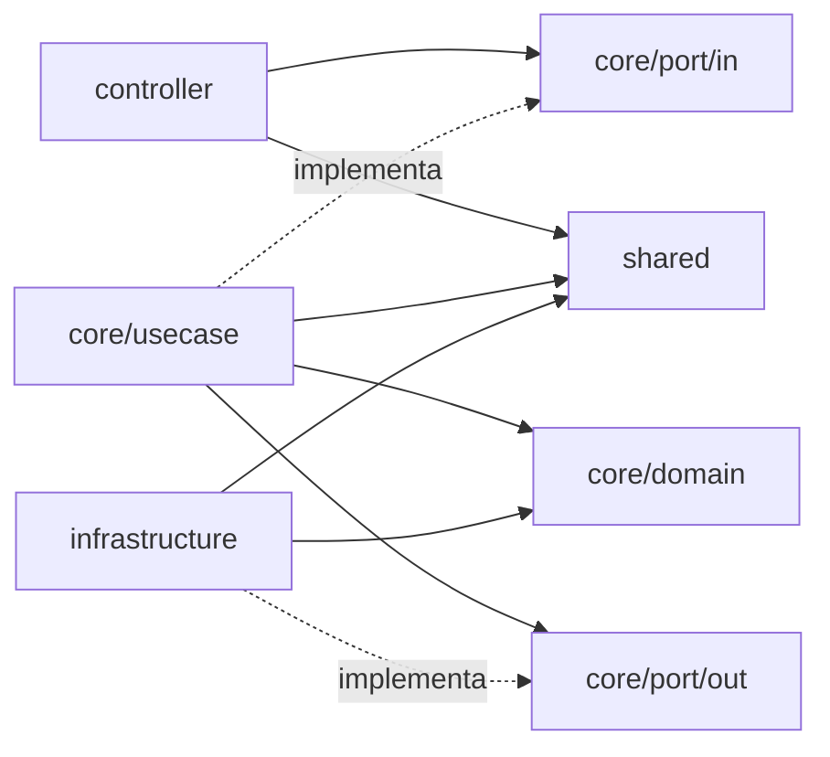

# ADR 001 — Monólito em camadas (ports & adapters)

- **Status:** Proposto
- **Data:** 2026-10-23
- **Responsável:** Ana Albuquerque

## Contexto

A API atende o fluxo de uma oficina mecânica. Ela cuida de autenticação, cadastro de clientes e veículos, catálogo de
serviços, peças e insumos, ordens de serviço (OS) e o acompanhamento da OS pelo cliente. Esses contextos são muito
ligados entre si: uma OS reúne cliente, veículo, serviços e peças, e precisa de consistência entre eles, por exemplo na
baixa de estoque e no orçamento.

Restrições do projeto:

- Equipe pequena (grupo da pós-tech) e prazo curto por entrega.
- Um único banco PostgreSQL (ver [ADR 002](0002-escolha-do-banco-de-dados.md)).
- Execução local e avaliação via Docker Compose (`docker-compose.yml`).
- As regras de negócio precisam ser testadas sem subir o banco. Os testes de `core` usam JUnit e Mockito.
- A stack já foi definida: Java 25, Spring Boot 4, Spring Data JPA, MapStruct e Lombok. A escolha foi feita na reunião
  de 16/10 porque Java é a linguagem que a maioria da equipe domina.
- O projeto é **incremental**: o mesmo código será reaproveitado e ampliado nas próximas fases do Tech Challenge. A
  estrutura precisa aguentar essa evolução sem reescrita.
- Na mesma reunião, o André propôs a arquitetura hexagonal adaptada que ele já usa em outros projetos, "porque é bem
  fácil de se encontrar no fluxo". Ele montou a estrutura base do repositório nesse formato.
- O Event Storming (16/10) separou o problema em três agrupamentos: **ordem de serviço** (criação e ciclo de vida da OS,
  o core), **acompanhamento da OS pelo cliente** e **gestão administrativa** (cadastros de cliente, veículo, serviço e
  peça/insumo). Na OS, esses cadastros são apenas *selecionados*, e não criados.

Requisitos não funcionais que orientam esta decisão
([Miro](https://miro.com/app/board/uXjVEYDydiQ=/?share_link_id=413287603523)):

- **RNF05:** arquitetura em camadas com núcleo independente de infraestrutura. Controllers adaptam HTTP, casos de uso
  concentram a aplicação, portas definem dependências e adaptadores implementam integrações e persistência.
- **RNF06:** regras de negócio ficam no domínio e nos casos de uso. O núcleo não depende de controllers, frameworks web
  ou implementações de persistência.
- **RNF09:** casos de uso testáveis isoladamente, sem iniciar servidor HTTP ou banco de dados.
- **RNF10:** documentação OpenAPI gerada a partir dos contratos implementados.
- **RNF20:** cobertura de pelo menos 80% com testes unitários.

Precisamos decidir duas coisas: **como a aplicação é implantada** (um ou vários deployables) e **como o código é
organizado internamente**, para que as regras de negócio não fiquem presas ao framework e à persistência.

## Decisão

Adotamos um **monólito**: uma única aplicação Spring Boot, um artefato implantável e um banco. Internamente ele é
**organizado em camadas no estilo ports & adapters (hexagonal)**, e todas as dependências apontam para o `core`.

### Camadas

| Camada                           | Pacote                          | Responsabilidade                                                                                                                                                                                                                                                                                                     |
|----------------------------------|---------------------------------|----------------------------------------------------------------------------------------------------------------------------------------------------------------------------------------------------------------------------------------------------------------------------------------------------------------------|
| Adapter de entrada               | `controller`                    | Endpoints REST, separados por público: `admin` (cadastros e OS), `auth` (login e cadastro de usuários) e `cliente` (acompanhamento da OS). Uma interface `*API` com as anotações OpenAPI e as de rota (`@*Mapping`) e um `*Controller` que a implementa, declara o `@PreAuthorize` e chama o port in.                                         |
| Domínio                          | `core/domain`                   | Modelos e value objects com regras de negócio (`Cliente`, `Documento`, `Veiculo`, `Placa`). Sem Spring e sem JPA.                                                                                                                                                                                                    |
| Portas                           | `core/port/in`, `core/port/out` | Contratos. O `PortIn` descreve os casos de uso oferecidos e o `PortOut`, o que o core precisa do mundo externo (persistência etc.).                                                                                                                                                                                  |
| Casos de uso                     | `core/usecase`                  | Orquestram o domínio. Implementam o `PortIn` e dependem só de `PortOut` e do domínio.                                                                                                                                                                                                                                |
| Adapters de saída e configuração | `infrastructure`                | `persistence/<contexto>/`: entidade JPA, `*JpaRepository`, `*PersistenceMapper` e `*PersistenceAdapter`, que implementa o `PortOut`. `config/`: documentação (`docs`), segurança (`security`: filtro JWT, rotas públicas, CORS, ver [ADR 004](0004-seguranca.md)) e métricas (`metrics`). Esses aspectos nunca ficam no `core`. |
| Transversal                      | `shared`                        | Exceções (`ApplicationException`, `ErrorTemplate`), handler global e utilitários puros (validação de CPF/CNPJ, normalização de nome).                                                                                                                                                                                    |

Dentro de cada camada o código é **organizado por contexto** (`cliente`, `veiculo`, `servico`, `pecainsumo`,
`ordemservico`...). Esses contextos seguem os agrupamentos do Event Storming:

- **Gestão administrativa**: `cliente`, `veiculo`, `servico` e `pecainsumo`. São CRUDs expostos em `controller/admin`.
- **Ordem de serviço** (core do domínio): `ordemservico`. A OS *referencia* os cadastros da gestão administrativa pelos
  ports desses contextos e não é dona deles.
- **Acompanhamento pelo cliente**: o cliente autenticado (perfil `CLIENTE`) consulta as próprias OS em
  `/minhas-ordens`, exposto em `controller/cliente` ([ADR 004](0004-seguranca.md)).

A comunicação entre contextos é **síncrona**, por chamadas a ports dentro do mesmo processo. Não há fila nem eventos
nesta fase.

### Convenções

- Código e artefatos do sistema (pacotes, classes, métodos, endpoints, documentação) ficam em **português**, conforme
  decidido em 21/10.
- Mensagens de commit seguem Conventional Commits (decidido em 16/10). Começaram em inglês e, desde 27/10, são escritas
  em **português**, como o resto do projeto.

### Regra de dependência

| Camada           | Pode depender de                                        | Não pode depender de                                         |
|------------------|---------------------------------------------------------|--------------------------------------------------------------|
| `controller`     | `core/port/in`, contratos (DTOs) do port in, `shared`   | `core/usecase` (implementação), `infrastructure`             |
| `core/domain`    | `shared/exception`, utilitários puros de `shared/utils` | Spring, JPA, `infrastructure`, `controller`                  |
| `core/port`      | `core/domain`, DTOs dos casos de uso                    | entidades JPA, `infrastructure`                              |
| `core/usecase`   | `core/domain`, `core/port`, `shared`                    | `infrastructure` (repositórios, entidades JPA), `controller` |
| `infrastructure` | `core/domain`, `core/port`, `shared`                    | `core/usecase` (implementação concreta), `controller`        |
| `shared`         | bibliotecas utilitárias                                 | `core`, `infrastructure`, `controller`                       |

### Implementação de referência

Os contextos **`cliente`**, **`veiculo`** e **`ordemservico`** seguem o padrão por completo e servem de modelo para os
novos:

- `ClienteUseCase` depende de `ClientePortOut`, que recebe e devolve o modelo de domínio `Cliente`.
- `ClienteEntity`, `ClienteJpaRepository`, `ClientePersistenceMapper` e `ClientePersistenceAdapter` ficam em
  `infrastructure/persistence/cliente/`.
- Na OS, o agregado `OrdemServico` (com itens, histórico de status e a máquina de estados de `StatusOrdemServico`) fica
  em `core/domain/ordemservico`, sem JPA. As entidades `OrdemServicoEntity`, `ItemServicoOsEntity`, `ItemPecaOsEntity`
  e `HistoricoStatusOsEntity` ficam em `infrastructure/persistence/ordemservico/`.

**Entidades JPA nunca ficam no `core`.** Elas são detalhe do adapter de persistência e ficam em
`infrastructure/persistence/<contexto>/`. O `core/domain` guarda só os modelos de domínio, que o `*PersistenceMapper`
converte. As datas de criação e de alteração ficam numa superclasse só, a `EntidadeComDatas` (`@MappedSuperclass` em
`infrastructure/persistence/`), herdada pelas entidades com `created_at`/`updated_at`. Isso evita repetir os campos e os
callbacks em cada entidade sem levar JPA para o domínio.

### Exceções aceitas conscientemente

- **`@Service` nos casos de uso.** Evita uma configuração manual de beans para cada use case. O custo é uma dependência
  leve do Spring no `core/usecase`. Pelo mesmo motivo, os casos de uso também usam o `@Transactional`
  ([ADR 003](0003-estrategia-de-transacoes.md)), o `PasswordEncoder` do Spring Security no cadastro e no login, o
  `@Value` para ler configuração (`LimiteTentativasLogin`, `JwtTokenProviderUseCase`) e mappers do MapStruct
  (`core/usecase/<contexto>/mapper`) entre DTO e modelo de domínio. O domínio fica sem nenhuma delas.
- **DTOs de request e response como contrato do port in.** Os controllers e os casos de uso trocam `*Request` e
  `*Response`, com anotações `jakarta.validation`, em vez de criar uma camada extra de comandos. Esses DTOs não são
  modelos de domínio e não devem carregar regra de negócio.

## Alternativas consideradas

### 1. Microsserviços (um serviço por contexto)

- **Prós:** deploy e escala independentes por contexto, isolamento de falhas, liberdade de tecnologia por serviço.
- **Contras:** a OS precisa de consistência entre cliente, veículo, serviço e estoque. Em serviços separados isso
  exigiria transações distribuídas ou sagas. Também traria latência de rede, service discovery, observabilidade
  distribuída e vários pipelines e bancos.
- **Por que não:** o custo operacional e de complexidade é desproporcional ao tamanho da equipe e do domínio. Não há
  hoje requisito de escala independente.

### 2. Camadas clássicas (controller → service → repository)

- **Prós:** é o padrão mais conhecido no Spring, tem menos classes e menos mapeamentos, e a curva de aprendizado é
  menor.
- **Contras:** as entidades JPA viram o modelo de domínio, então regra de negócio e persistência ficam acopladas. Os
  services dependem direto dos repositórios, o que dificulta testar sem banco e trocar a persistência.
- **Por que não:** perdemos o domínio testável e isolado. Parte do código (`servico`, `pecainsumo`, `usuario`) seguiu
  esse formato até o #121, que separou o modelo de domínio da entidade JPA.

### 3. Monólito modular com módulos isolados (Spring Modulith ou módulos Maven)

- **Prós:** fronteiras entre contextos verificadas pelo build ou por testes, e facilidade para extrair um microsserviço
  no futuro.
- **Contras:** traz mais configuração e mais decisões agora, como eventos entre módulos e a API pública de cada módulo,
  e a equipe ainda está consolidando o padrão de camadas.
- **Por que não, por enquanto:** fica como **evolução natural** desta decisão. A organização por contexto dentro de cada
  camada já prepara esse caminho.

### 4. Clean Architecture "pura" (nenhuma dependência de framework no core)

- **Prós:** isolamento total do framework, com o core sendo Java puro.
- **Contras:** exige configuração manual de beans, comandos e modelos de saída separados dos DTOs, e muito mais
  mapeamento.
- **Por que não:** pouco ganho prático para o tamanho do projeto. Aceitamos as exceções listadas na Decisão.

### 5. Vertical Slice (organização por funcionalidade)

- **Prós:** cada funcionalidade (ex.: abrir OS, aprovar orçamento) fica numa fatia própria, com entrada, caso de uso e
  persistência juntos. Tem menos abstrações, baixo acoplamento entre funcionalidades e combina bem com CQRS.
- **Contras:** há risco de duplicação e de inconsistência entre as fatias. Várias funcionalidades da OS usam as mesmas
  regras (reserva de estoque, validação de CPF/CNPJ, placa), que teriam de ser compartilhadas de qualquer forma. O
  padrão também não isola o domínio do framework e da persistência.
- **Por que não:** o domínio gira em torno da OS, que tem regras ricas e compartilhadas entre funcionalidades, e o
  problema que queremos resolver é testar essas regras sem banco. A organização por contexto dentro de cada camada já
  agrupa o código de cada assunto.

### 6. Onion Architecture

- **Prós:** tem o mesmo objetivo da hexagonal: dependências apontando para o domínio e contratos (ports) entre o núcleo
  e a infraestrutura, mas com anéis nomeados (domínio, serviços de domínio, serviços de aplicação e infraestrutura).
- **Contras:** na prática, a diferença é de nomenclatura. A separação entre serviços de domínio e de aplicação
  acrescenta uma camada de que o projeto ainda não precisa.
- **Por que não:** é muito próxima do que adotamos. Ficamos com o vocabulário de ports & adapters porque a estrutura
  base do repositório já foi montada nele (`port/in`, `port/out`).

### 7. Comunicação assíncrona entre contextos (fila/eventos)

- **Prós:** desacopla os contextos, por exemplo na reserva de estoque ou na notificação de mudança de status, e prepara
  o terreno para uma futura separação em serviços.
- **Contras:** exige um broker, idempotência, retentativas e consistência eventual, além de deixar os testes e o debug
  mais difíceis.
- **Por que não, por enquanto:** foi discutida no Event Storming (16/10) e descartada nesta fase ("vai criar problema
  pra gente"). Não haverá notificação ativa: o cliente consulta o status da OS quando quiser. Se for necessária nas
  próximas fases, entra como um novo adapter de saída, sem mudar o `core`.

## Consequências

### Positivas

- Deploy, execução local e debug simples: uma imagem Docker e um banco.
- Transações locais no PostgreSQL, sem consistência distribuída (ver [ADR 003](0003-estrategia-de-transacoes.md)).
- Domínio e casos de uso testáveis sem banco, com mocks dos ports (ex.: `ClienteUseCaseTest`, `VeiculoUseCaseTest`,
  `PlacaTest`). A estratégia de testes está na [ADR 005](0005-estrategia-de-testes.md).
- A troca ou evolução de um adapter (outro banco, outro canal de entrada) fica isolada em `infrastructure` e
  `controller`.
- Fronteiras por contexto facilitam a evolução para um monólito modular ou a extração de um serviço.
- Facilita a evolução entre as fases do Tech Challenge. Mensageria, observabilidade e integrações externas podem entrar
  como novos adapters, sem reescrever o domínio.

### Negativas e trade-offs

- Mais classes e mapeamentos por contexto (entidade JPA, modelo de domínio, DTOs e mappers).
- Curva de aprendizado: ports, adapters e a regra de dependência são novos para parte da equipe. Num projeto do nosso
  tamanho, a quantidade de abstrações pesa mais do que pesaria num sistema grande.
- A aplicação escala só como um todo. Um bug ou um deploy afeta todos os contextos.
- Hoje, a regra de dependência depende de disciplina e de code review. A mitigação planejada é adicionar testes de
  arquitetura (ArchUnit) ao pipeline que já roda Sonar e JaCoCo em cada PR, para que uma violação de camada reprove o
  PR ([ADR 005](0005-estrategia-de-testes.md)).
- As métricas de negócio e de segurança (Micrometer, expostas em `/actuator/prometheus` e lidas pelo Prometheus e pelo
  Grafana do compose) entraram antes do previsto em 21/10. A configuração fica em `infrastructure/config/metrics`, mas
  os casos de uso registram contadores direto no `MeterRegistry`, o que é mais uma dependência leve no `core`. A
  padronização de logs (`action=... chave=valor`) segue o mesmo caminho.
- Nenhuma entidade JPA fica no `core`, e o `UsuarioUseCase` usa o `UsuarioPortOut` em vez dos repositórios. Ainda
  ficam fora do padrão: os repositórios de `usuario`, `servico` e `pecainsumo` em
  `infrastructure/persistence/repository/` (e não em `persistence/<contexto>/`); `Servico` e `PecaInsumo`, que são
  modelos anêmicos (getters e setters, com a validação no caso de uso, e não no modelo como em `Cliente`); e, na
  segurança, `Perfil` implementa `GrantedAuthority` e o JWT é gerado em `core/usecase/auth`
  ([ADR 004](0004-seguranca.md)). O pente fino de 29/10 achou mais um ponto: os DTOs `*Request`/`*Response` ficam
  em `core/domain/<contexto>/model`, misturados aos modelos de domínio, quando o lugar de um contrato do port in é
  `core/port/in/<contexto>/`. O resto do que ele achou já foi corrigido: o `JwtAuthenticationFilter` usa o port in
  (#122), o `UsuarioPayload` saiu de `shared` para `core/usecase/usuario` (#124) e o pacote `pecaInsumo` passou a ser
  `pecainsumo`, em minúsculas como os outros contextos. As correções são acompanhadas como issues de
  dívida técnica no repositório.

## Referências

- [ADR 002 — Escolha do banco de dados](0002-escolha-do-banco-de-dados.md)
- [ADR 003 — Estratégia de transações](0003-estrategia-de-transacoes.md): inclui a reserva de estoque na geração do
  orçamento e a liberação quando o orçamento é reprovado, discutidas no Event Storming.
- [ADR 004 — Segurança: autenticação e autorização](0004-seguranca.md)
- [ADR 005 — Estratégia de testes](0005-estrategia-de-testes.md)
- [Modelo C4](../arquitetura/c4.md): o nível 3 mostra as camadas desta ADR como componentes da API
- Event Storming do grupo (Miro) e a reunião de 16/10/2026
- [Requisitos não funcionais (Miro)](https://miro.com/app/board/uXjVEYDydiQ=/?share_link_id=413287603523)
- Decisões registradas no grupo do time entre 16/10 e 27/10/2026
- Alistair Cockburn, *Hexagonal Architecture* (2005)
