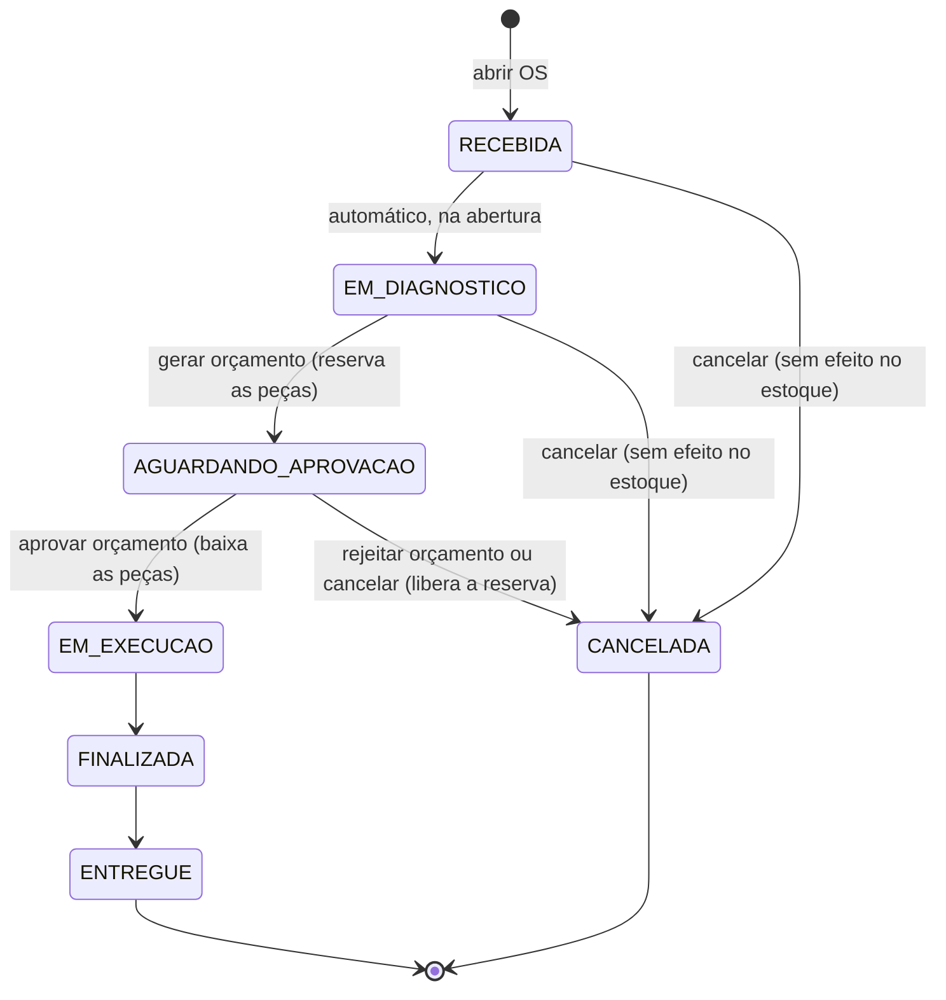

# ADR 003 — Estratégia de transações

- **Status:** Proposto
- **Data:** 2026-10-23
- **Responsável:** Ana Albuquerque

## Contexto

Os fluxos principais da oficina gravam em mais de uma tabela de uma vez. As regras de estoque são as que mais pedem
consistência. No Event Storming (16/10) ficou definido:

- o estoque é **reservado** quando o orçamento é gerado;
- a reserva é **liberada** se o orçamento for reprovado;
- o estoque é **baixado** quando o orçamento é aprovado.

A pergunta levantada na call foi: "quem me garante que nesse momento eu tenha estoque ainda?". Duas OS podem tentar
reservar a última unidade da mesma peça ao mesmo tempo. Um orçamento também pode ser aprovado duas vezes, por duplo
clique ou por um reenvio do cliente.

Requisitos não funcionais relacionados ([Miro](https://miro.com/app/board/uXjVEYDydiQ=/?share_link_id=413287603523)):

- **RNF08:** operações transacionais de estoque e orçamento devem preservar a consistência mesmo em falhas ou
  requisições concorrentes. Não podem gerar saldo negativo, reservas parciais ou consumo/devolução duplicados.
- **RNF04:** quando a API ou o banco estiver indisponível, as operações afetadas devem responder com status 503 e
  mensagem explícita, sem gravar alterações parciais.

Restrições que já vêm das ADRs anteriores:

- Monólito com um único banco ([ADR 001](0001-monolito-em-camadas.md)). Não há transação distribuída: tudo cabe numa
  transação local.
- PostgreSQL 18 com transações ACID, acessado por Spring Data JPA atrás dos `PortOut`
  ([ADR 002](0002-escolha-do-banco-de-dados.md)). O estoque fica nas colunas `quantidade` e `reservado` de
  `peca_insumo`.

Problemas que o código tinha antes desta ADR:

- O `@Transactional` ficava só nos `*PersistenceAdapter`, um por chamada ao `PortOut`. Um caso de uso que chamava dois
  adapters fazia duas transações. Se a segunda falhasse, a primeira já estava gravada.
- No cadastro de usuário, o `@Transactional` estava num método **privado** chamado de dentro da própria classe. O proxy
  do Spring não intercepta essa chamada, então a anotação não tinha efeito, e identidade, contato, endereço e usuário
  eram gravados em transações separadas.
- Não havia controle de concorrência no estoque nem tratamento de 503 quando o banco caía (a resposta era um 500
  genérico).

Fluxos cobertos por esta ADR:

| Fluxo                         | Rota                                           | Escritas envolvidas                              |
|-------------------------------|------------------------------------------------|--------------------------------------------------|
| Abrir ou editar a OS          | `POST` e `PUT /ordens-servico`                 | OS, itens de serviço e de peça, histórico        |
| Gerar orçamento               | `PATCH /ordens-servico/{id}/gerar-orcamento`   | Status da OS, histórico, reserva de cada peça    |
| Aprovar orçamento             | `PATCH /ordens-servico/{id}/aprovar-orcamento` | Status da OS, histórico, baixa de cada peça      |
| Rejeitar orçamento            | `PATCH /ordens-servico/{id}/rejeitar-orcamento` | Status da OS (`CANCELADA`), liberação das peças |
| Cancelar, finalizar, entregar | `PATCH /ordens-servico/{id}/status`            | Status da OS, histórico e, no cancelamento com orçamento pendente, liberação das peças |
| Cancelar (só `ADMIN`)         | `DELETE /ordens-servico/{id}`                  | O mesmo cancelamento do `PATCH .../status`: a OS vira `CANCELADA` e não é apagada (#109) |
| Cadastro de usuário           | `POST /auth/cadastro`                          | Usuário                                          |

## Decisão

Usamos **transações locais do PostgreSQL, uma por caso de uso**, com isolamento `READ COMMITTED`. A consistência do
estoque vem de **`UPDATE`s condicionais atômicos**, e a proteção contra duplicidade vem de uma **transição de status
condicional** da OS.

### 1. Fronteira: um caso de uso, uma transação

- O método **público** do caso de uso (`core/usecase`, já anotado com `@Service`) recebe `@Transactional`. Tudo o que
  ele faz pelos `PortOut` entra na mesma transação.
- Os `*PersistenceAdapter` continuam anotados. Com a propagação padrão (`REQUIRED`), eles entram na transação do caso de
  uso. Se forem chamados fora de um caso de uso, abrem a própria transação.
- Casos de uso só de leitura usam `@Transactional(readOnly = true)`.
- `@Transactional` nunca vai em método privado nem em método chamado pela própria classe, porque nesses casos o proxy do
  Spring não atua.
- `ApplicationException` estende `RuntimeException`, então qualquer erro de negócio desfaz a transação inteira sem
  configuração extra.
- `spring.jpa.open-in-view: false`: a sessão do Hibernate não fica aberta durante a renderização da resposta. A conexão
  é devolvida ao pool quando o caso de uso termina, e um lazy loading fora da transação falha cedo, em vez de abrir
  consultas escondidas no controller.

### 2. Estoque: `UPDATE` condicional atômico

A regra "tem saldo?" e a alteração do saldo acontecem **no mesmo comando SQL**. Assim, não sobra intervalo entre ler e
gravar:

| Operação | Comando                                                                                                              |
|----------|----------------------------------------------------------------------------------------------------------------------|
| Reservar | `UPDATE peca_insumo SET reservado = reservado + :q WHERE id = :id AND quantidade - reservado >= :q`                  |
| Liberar  | `UPDATE peca_insumo SET reservado = reservado - :q WHERE id = :id AND reservado >= :q`                               |
| Baixar   | `UPDATE peca_insumo SET quantidade = quantidade - :q, reservado = reservado - :q WHERE id = :id AND reservado >= :q AND quantidade >= :q` |

- O comando devolve o número de linhas afetadas. Se for `0`, a condição não foi atendida (sem saldo ou reserva
  inexistente). O caso de uso lança `ApplicationException` com **409**, e a transação inteira é desfeita, inclusive as
  peças que já tinham sido reservadas. Isso evita reserva parcial.
- No PostgreSQL, o `UPDATE` trava a linha até o fim da transação. Uma segunda transação que tente reservar a mesma peça
  espera a primeira terminar e então **reavalia o `WHERE` sobre o valor já confirmado** (comportamento do
  `READ COMMITTED`). Por isso duas OS nunca reservam a mesma unidade.
- As peças de uma OS são atualizadas **em ordem crescente de `id`**. Duas transações que disputam as mesmas peças travam
  as linhas na mesma ordem, o que evita deadlock.
- Os comandos ficam no adapter de persistência (`@Modifying @Query` no `*JpaRepository`), expostos por métodos do
  `PecaInsumoPortOut` que retornam se a operação foi feita (ex.: `boolean reservar(Long id, int quantidade)`).

### 3. Duplicidade: transição de status condicional

A OS terá uma máquina de estados. Cada transição só acontece se a OS estiver no status esperado:

```sql
UPDATE ordem_servico
SET status = :novo
WHERE id = :id
  AND status = :esperado
```

- Se nenhuma linha for afetada, outra requisição já fez a transição (ou a OS está num status que não permite a ação). O
  caso de uso responde **409** e **não mexe no estoque**.
- A transição de status vem **antes** do movimento de estoque, na mesma transação. A segunda requisição de "aprovar"
  fica bloqueada na linha da OS e, quando a primeira confirma, não encontra mais o status esperado. Assim não existe
  baixa nem devolução duplicada.
- A ordem dentro de cada transação é sempre: **1) transição de status → 2) movimento de estoque → 3) gravação dos itens
  e valores**.

#### Situação da implementação

A OS valida a transição no domínio (`StatusOrdemServico.podeTransitarPara`), movimenta o estoque e grava o agregado com
`save()` do JPA. O `UPDATE` da OS **não tem a condição de status**, e a `OrdemServicoEntity` não tem `@Version`. Em
requisições sequenciais, a regra funciona: a segunda recebe 409 porque o status já mudou. Em requisições
**simultâneas**, as duas leem o mesmo status e passam pela validação:

- dois `gerar-orcamento` reservam as peças duas vezes, se houver saldo;
- dois `aprovar-orcamento` ou dois cancelamentos só são barrados pelo `WHERE` do estoque. Se outra OS tiver reserva da
  mesma peça, a segunda requisição consome ou libera a reserva da outra OS.

O caminho proposto é **`@Version` na `OrdemServicoEntity`**, com a `OptimisticLockException` traduzida para 409 no
`HandlerException`. A segunda requisição falha no `save()`, e o rollback desfaz também o movimento de estoque, porque
tudo está na mesma transação. Para o status da OS, o conflito é raro (duplo clique, reenvio), então o lock otimista não
tem o problema que tem no estoque (alternativa 4). Até essa correção entrar, a proteção contra duplicidade simultânea é
uma dívida técnica.

### 4. Efeito de cada transição no estoque

A máquina de estados é a do `StatusOrdemServico`. A OS avança uma etapa por vez, sem voltar nem pular status.



| Transição                                     | Estoque                                                   |
|-----------------------------------------------|-----------------------------------------------------------|
| Incluir ou alterar peça na OS                 | Nenhum: só confere o saldo disponível (sem reservar)      |
| Gerar orçamento                               | Reserva cada peça do orçamento                            |
| Aprovar orçamento                             | Baixa o que foi reservado                                 |
| Rejeitar orçamento                            | Libera a reserva e cancela a OS                           |
| Cancelar com orçamento pendente               | Libera a reserva                                          |
| Cancelar antes do orçamento                   | Nenhum: ainda não há reserva                              |
| Cancelar depois da aprovação                  | Não permitido: a partir de `EM_EXECUCAO` a OS só avança   |

Regras que complementam o diagrama:

- `EM_DIAGNOSTICO`, `AGUARDANDO_APROVACAO` e `EM_EXECUCAO` são **automáticos**: vêm da abertura e das rotas de
  orçamento, e o `PATCH /status` recusa esses destinos com 409. Pelo `PATCH /status` só se cancela, finaliza ou
  entrega.
- Os itens só mudam em `RECEBIDA` e `EM_DIAGNOSTICO`. Depois que o orçamento é gerado, a OS fica **congelada**: o valor
  aprovado é o valor reservado.
- A aprovação e a rejeição do orçamento são registradas pelo funcionário ([ADR 004](0004-seguranca.md)).
- O cancelamento não apaga a OS: ela vai para `CANCELADA`, que é um status final (delete lógico, decisão de 21/10).

### 5. Erros e respostas HTTP

| Situação                                                                                                                                                      | Resposta                           | Gravação       |
|---------------------------------------------------------------------------------------------------------------------------------------------------------------|------------------------------------|----------------|
| Sem saldo, reserva inexistente ou transição inválida                                                                                                          | 409 com mensagem de negócio        | Rollback total |
| Banco indisponível, falha ao abrir a transação ou timeout (`DataAccessResourceFailureException`, `CannotCreateTransactionException`, `QueryTimeoutException`) | 503 com mensagem explícita (RNF04) | Rollback total |

O tratamento fica no `HandlerException` (`shared/handler`). O servidor **não tenta de novo** automaticamente. Quem chama
decide se reenvia, e a transição condicional garante que um reenvio não duplica o efeito.

### 6. Cadastro de usuário

`AuthenticationUseCase.cadastrarUsuario` é a fronteira da transação, e o `@Transactional` saiu do método privado que
não tinha efeito. Com a migration V8, a identidade, o contato e o endereço deixaram de existir, e o usuário guarda só
nome e e-mail. O cadastro grava uma tabela só, mas a fronteira continua no caso de uso para valer quando o cadastro
voltar a gravar mais de uma tabela.

## Alternativas consideradas

| Alternativa                               | Tema         | Situação                                               |
|-------------------------------------------|--------------|--------------------------------------------------------|
| **Transação no caso de uso**              | Fronteira    | **Escolhida**                                          |
| Transação só no adapter                   | Fronteira    | Descartada: não é atômica entre escritas               |
| Port de transação (`TransactionTemplate`) | Fronteira    | Descartada por enquanto: mais código sem ganho prático |
| **`UPDATE` condicional atômico**          | Concorrência | **Escolhida**                                          |
| Lock pessimista (`SELECT ... FOR UPDATE`) | Concorrência | Viável, sem vantagem                                   |
| Lock otimista (`@Version`) no estoque     | Concorrência | Descartada: exige retry                                |
| Lock otimista (`@Version`) na OS          | Duplicidade  | Proposta para implementar a transição condicional      |
| Isolamento `SERIALIZABLE`                 | Concorrência | Descartada: exige retry em todo conflito               |
| **Transição de status condicional**       | Duplicidade  | **Escolhida**                                          |
| Chave de idempotência                     | Duplicidade  | Evolução futura                                        |
| Retry automático no servidor              | Erros        | Descartada                                             |
| Sagas / transações distribuídas           | Arquitetura  | Não se aplica (monólito)                               |

### 1. Transação só nos adapters (situação anterior)

- **Prós:** nenhuma anotação de transação no `core`, e cada adapter é simples.
- **Contras:** cada chamada ao `PortOut` confirma sozinha. Na geração do orçamento, uma falha na terceira peça deixaria
  as duas primeiras reservadas e a OS sem status novo, que é exatamente a reserva parcial que o RNF08 proíbe.
- **Por que não:** não atende o RNF08 em fluxos com mais de uma escrita.

### 2. Port de transação no `core`

Um `TransacaoPortOut.executar(Supplier<T>)` implementado em `infrastructure` com `TransactionTemplate`.

- **Prós:** o `core/usecase` não depende de `org.springframework.transaction`.
- **Contras:** mais uma abstração e um lambda em cada caso de uso, e o código fica menos idiomático para quem conhece
  Spring. A ADR 001 já aceitou uma dependência leve do Spring no `core/usecase` (`@Service`). `@Transactional` é da
  mesma natureza: uma anotação declarativa, sem lógica.
- **Por que não, por enquanto:** o custo não se paga nesta fase. Se o `core` for isolado do Spring no futuro
  (alternativa 4 da ADR 001), este é o caminho.

### 3. Lock pessimista (`SELECT ... FOR UPDATE`)

O caso de uso carrega as peças com `@Lock(PESSIMISTIC_WRITE)`, confere o saldo no Java e grava.

- **Prós:** a regra fica no Java e fica fácil de ler. Também é seguro em `READ COMMITTED`.
- **Contras:** duas idas ao banco (ler e gravar) em vez de uma. As linhas ficam travadas desde a leitura, inclusive
  durante validações que não precisam delas. Também é preciso lembrar de travar sempre e na mesma ordem.
- **Por que não:** o `UPDATE` condicional entrega a mesma garantia com um comando só e com o lock pelo menor tempo
  possível. Fica como opção se a regra de saldo ficar complexa demais para um `WHERE`.

### 4. Lock otimista (`@Version`) no estoque

- **Prós:** não trava linhas na leitura e é o padrão do JPA para edições concorrentes.
- **Contras:** um conflito gera `OptimisticLockException` depois de todo o trabalho ter sido feito. Para estoque
  disputado, conflito é o caso comum, e não a exceção. Isso exigiria retry, mais uma migration (`version` em
  `peca_insumo`) e cuidado para o retry não duplicar efeitos.
- **Por que não:** troca uma espera curta no banco por retentativas na aplicação, sem ganho para o nosso volume.

### 5. Isolamento `SERIALIZABLE`

- **Prós:** o PostgreSQL detecta qualquer anomalia de concorrência, sem precisar pensar em cada comando.
- **Contras:** toda transação conflitante falha com erro de serialização (`40001`) e precisa ser repetida inteira. O
  custo de detecção vale para todas as transações, não só para as de estoque.
- **Por que não:** os pontos de conflito são conhecidos e poucos (saldo da peça e status da OS), e os dois são
  resolvidos por `UPDATE`s condicionais em `READ COMMITTED`.

### 6. Chave de idempotência

Header `Idempotency-Key` com uma tabela de requisições já processadas, que devolve a mesma resposta num reenvio.

- **Prós:** um reenvio do cliente recebe a resposta original, e não um 409.
- **Contras:** mais uma tabela, expiração das chaves e mudança no contrato da API.
- **Por que não, por enquanto:** a transição de status já impede o efeito duplicado. A chave melhora só a experiência de
  quem reenvia. Fica como **evolução** caso apareça um cliente que reenvie automaticamente (ex.: integração de
  pagamento).

### 7. Retry automático no servidor

- **Prós:** esconde falhas transitórias, como um deadlock eventual ou uma queda rápida de conexão.
- **Contras:** mais uma dependência (Spring Retry) e o risco de repetir efeitos se a operação não for idempotente. Se o
  banco estiver fora, o retry só atrasa o 503.
- **Por que não:** com o `UPDATE` condicional e a ordem fixa das peças, não esperamos conflitos que valham um retry. O
  RNF04 pede resposta explícita, e não espera.

### 8. Sagas e transações distribuídas

- **Por que não:** só fazem sentido com vários serviços ou bancos. A ADR 001 define um monólito com um único banco,
  então uma transação local resolve.

## Consequências

### Positivas

- Cada fluxo é atômico: OS e estoque mudam juntos ou nada muda (RNF08).
- Não há saldo negativo nem reserva da mesma unidade por duas OS, sem retry e sem lock longo: a linha fica travada só
  entre o `UPDATE` e o commit.
- Aprovar, reprovar ou cancelar duas vezes não duplica efeito no estoque. A segunda requisição recebe 409.
- Banco fora do ar vira 503 com mensagem clara, e não 500 genérico (RNF04).
- A regra é testável: nos testes unitários do `core`, o `PortOut` mockado devolve `false` para simular falta de saldo ou
  transição já feita ([ADR 005](0005-estrategia-de-testes.md)).
- O cadastro de usuário deixa de gravar dados parciais.

### Negativas e trade-offs

- Parte da regra de estoque fica no SQL do adapter (o `WHERE` do `UPDATE`), e não só no domínio. Ela precisa de teste de
  integração com PostgreSQL de verdade (Testcontainers, [ADR 005](0005-estrategia-de-testes.md)) para ser validada,
  e ainda não há teste que dispare requisições simultâneas.
- A transição de status condicional ainda não está implementada (ver "Situação da implementação" na seção 3). Até
  entrar o `@Version`, duas requisições simultâneas na mesma OS podem duplicar a reserva ou consumir a reserva de outra
  OS.
- `@Transactional` aumenta a dependência do Spring no `core/usecase`, além do `@Service` já aceito na ADR 001.
- Os `UPDATE`s via `@Modifying @Query` não passam pelo ciclo de vida do Hibernate. Entidades já carregadas na mesma
  transação podem ficar desatualizadas e precisam ser recarregadas, ou a query deve usar `clearAutomatically = true`.
- Um reenvio legítimo do cliente recebe 409 em vez da resposta original até existir chave de idempotência.
- Com `open-in-view` desligado, qualquer relacionamento lazy precisa ser carregado dentro do caso de uso. Senão, ocorre
  `LazyInitializationException`.

## Referências

- [ADR 001 — Monólito em camadas (ports & adapters)](0001-monolito-em-camadas.md)
- [ADR 002 — Escolha do banco de dados](0002-escolha-do-banco-de-dados.md)
- [ADR 004 — Segurança: autenticação e autorização](0004-seguranca.md)
- [ADR 005 — Estratégia de testes](0005-estrategia-de-testes.md)
- [Diagramas de sequência da OS](../arquitetura/sequencia-ordem-servico.md): abertura, orçamento e mudança de status, com a transação e o `UPDATE` de estoque de cada passo
- PR #104: rotas de orçamento com reserva, baixa e liberação do estoque
- PR #109: `DELETE /ordens-servico/{id}` como cancelamento, só para `ADMIN`
- Event Storming do grupo (Miro) e a reunião de 16/10/2026
- [Requisitos não funcionais (Miro)](https://miro.com/app/board/uXjVEYDydiQ=/?share_link_id=413287603523)
- [Spring Framework — Declarative transaction management](https://docs.spring.io/spring-framework/reference/data-access/transaction/declarative.html)
- [PostgreSQL 18 — Transaction Isolation (Read Committed)](https://www.postgresql.org/docs/18/transaction-iso.html)
- [PostgreSQL 18 — Explicit Locking](https://www.postgresql.org/docs/18/explicit-locking.html)
