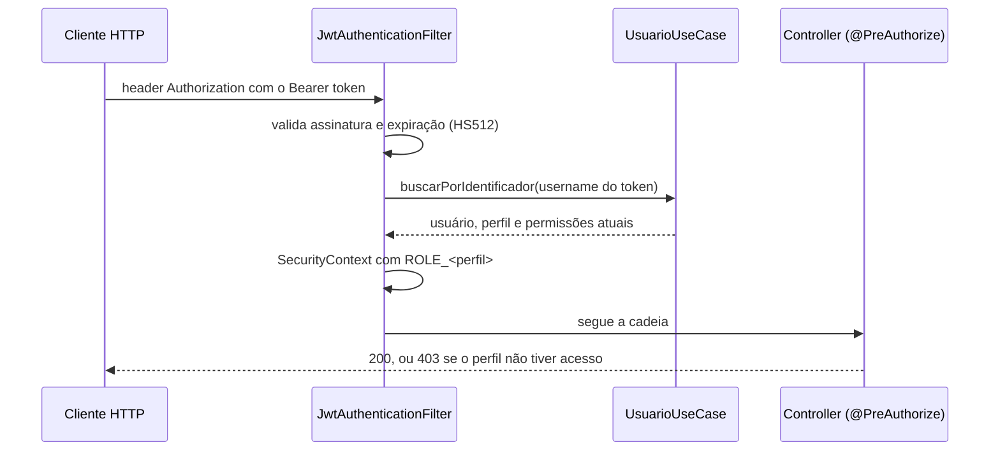

# ADR 004 — Segurança: autenticação e autorização

- **Status:** Proposto
- **Data:** 2026-10-23
- **Responsável:** Ana Albuquerque

## Contexto

A API é usada por três tipos de pessoa: o administrador da oficina, os funcionários e os clientes, que acompanham as
próprias ordens de serviço (OS). Ela guarda dados pessoais de clientes (nome, CPF/CNPJ, e-mail, telefone, endereço) e
dos usuários do sistema, então está sujeita à LGPD. Não há front próprio nesta fase: a API é chamada pelo Swagger, pelo
Postman ou por um front de terceiros, e a avaliação roda via Docker Compose.

Requisitos não funcionais de segurança ([Miro](https://miro.com/app/board/uXjVEYDydiQ=/?share_link_id=413287603523)):

- **RNF01:** senhas guardadas só como hash BCrypt. Senhas provisórias geradas com mecanismo criptograficamente seguro,
  exibidas uma única vez e nunca registradas em log.
- **RNF02:** autenticação por token Bearer. Tokens antigos devem ser invalidados depois de alteração ou redefinição de
  senha e depois da exclusão da conta.
- **RNF03:** operações protegidas exigem autenticação e perfil. No Miro, todas as contas de funcionário usavam o perfil
  Administrador, e a aprovação do orçamento e a consulta do status da OS eram públicas. Essa parte foi revista (ver
  abaixo).
- **RNF12:** senha com no mínimo 8 caracteres. No primeiro acesso com senha provisória, o sistema fica bloqueado até a
  troca, e as tentativas malsucedidas de troca são limitadas.
- **RNF13:** listagens de OS e histórico do veículo não expõem dados pessoais ou de contato do cliente além do
  necessário. A consulta de status pelo cliente não expõe valores internos nem nomes de usuários internos.
- **RNF14:** a mensagem de falha de autenticação não revela se o erro foi no e-mail ou na senha.

Decisões do time que mudam o RNF03:

- **Perfis da fase 1 (reunião de 25/10):** `ADMIN`, `FUNCIONARIO` e `CLIENTE`. Gerente, mecânico, estoquista e
  atendente ficam para a fase 2. O funcionário cadastra e edita, mas não exclui. Cadastrar usuários é só do
  administrador (27/10).
- **Aprovação do orçamento registrada pelo funcionário:** não há rota pública de aprovação nesta fase. A aprovação
  pelo próprio cliente, com token, fica para a fase 2.
- **Acompanhamento pelo cliente autenticado:** o cliente faz login e vê só as OS dele, em vez de uma consulta pública
  por número da OS.

Restrições:

- Monólito com um único banco ([ADR 001](0001-monolito-em-camadas.md)). Roda numa instância só, sem gateway nem
  servidor de identidade.
- Stack Spring Boot 4 com Spring Security, já definida (16/10).
- Equipe pequena, prazo curto e o projeto será ampliado nas próximas fases.
- A referência de riscos é o OWASP Top 10, principalmente controle de acesso quebrado (A01), falhas criptográficas (
  A02), injeção (A03) e falhas de autenticação (A07).

## Decisão

Usamos **Spring Security com JWT stateless**: o login devolve um token assinado, e toda requisição fora da lista de
rotas públicas precisa dele. A autorização é **por perfil**, declarada com `@PreAuthorize` nos controllers. Tudo o que
é configuração de segurança fica em `infrastructure/config/security`.

### 1. Autenticação: JWT stateless

- `POST /auth/login` recebe `identificador` (nome de usuário ou e-mail) e `senha` e devolve `Bearer <token>`.
- O token é assinado com **HMAC-SHA512** (`jjwt`) e expira em **1 hora**. A chave vem de `API_SECRET`, sem valor
  padrão no `application.yaml`: sem a variável, a API não sobe. O `.env.example` orienta a gerar com
  `openssl rand -base64 64`.
- Sem sessão no servidor (`SessionCreationPolicy.STATELESS`), sem `httpBasic` e sem `formLogin`.
- A cada requisição, o `JwtAuthenticationFilter` valida o token e **recarrega o usuário do banco**. O perfil vem do
  banco, e não do claim do token. Assim, mudar o perfil de alguém vale na próxima requisição, e o token de um usuário
  que não existe mais é recusado. O custo é uma consulta por requisição.
- O filtro é o único lugar que lê o header `Authorization`. Os controllers recebem o usuário pelo
  `@AuthenticationPrincipal` e nunca recebem o token como parâmetro. Isso foi tentado no #98 e desfeito no #99: o
  parâmetro duplicava a validação, aparecia no Swagger como campo obrigatório e dava a impressão de que a rota se
  protegia sozinha.
- O filtro roda só dentro da cadeia do Spring Security. O registro automático como filtro de servlet está desligado
  (`FilterRegistrationBean.setEnabled(false)`), senão ele rodaria duas vezes ou fora da cadeia.

### 2. Senhas

- Guardadas com o `DelegatingPasswordEncoder` do Spring Security, que usa **BCrypt** por padrão e grava o prefixo
  `{bcrypt}` no hash (RNF01). O prefixo permite trocar de algoritmo no futuro sem invalidar as senhas antigas.
- Política (`PoliticaSenha`): de 8 a 64 caracteres, com maiúscula, minúscula, número e um especial de uma lista
  permitida. O limite de 64 evita o corte silencioso do BCrypt, que só considera os primeiros 72 bytes.
- A senha nunca vai para log, nem no cadastro nem no login.

### 3. Rotas públicas e "negar por padrão"

- `RotasPublicas` é o **único lugar** que libera rota sem token: `/auth/login`, `/auth/validate`, a documentação do
  Swagger e o `/actuator/**`, que expõe só `health` e `prometheus`. As rotas de `/auth` são listadas uma a uma, sem
  curinga.
- O resto cai no `anyRequest().authenticated()`. Uma rota nova **já nasce protegida**, e liberar uma rota é uma mudança
  visível no PR.
- O `RotasProtegidasTest` sobe todos os controllers e confere que cada rota fora de `RotasPublicas` responde **401** sem
  token e com token inválido. Um controller novo quebra esse teste até ter o mock da sua porta, o que obriga a pensar na
  segurança dele.
- Sem token ou com token inválido: **401**. Com token válido e perfil sem acesso: **403** com `"Acesso negado"`.

### 4. Autorização por perfil

`@EnableMethodSecurity` com `@PreAuthorize` nos controllers: na classe vai o acesso padrão, e no método, a exceção. O
perfil vira a authority `ROLE_<PERFIL>` (`Perfil implements GrantedAuthority`).

| Recurso                                                 | ADMIN | FUNCIONARIO | CLIENTE              |
|---------------------------------------------------------|:-----:|:-----------:|:--------------------:|
| `POST /auth/cadastro` (cadastrar usuário)               |   ✓   |      —      |          —           |
| Clientes, veículos, serviços e peças: criar, ler, editar |   ✓   |      ✓      |          —           |
| Clientes, veículos, serviços e peças: excluir           |   ✓   |      —      |          —           |
| Ordens de serviço e orçamento (`/ordens-servico`)       |   ✓   |      ✓      |          —           |
| Acompanhar as próprias OS (`/minhas-ordens`)            |   —   |      —      | ✓ (só as próprias)   |

- **O cliente só enxerga as próprias OS.** O usuário `CLIENTE` fica ligado ao cadastro do cliente (`usuarios.cliente_id`,
  único, migration V10), e o `clienteId` vem do usuário autenticado, **nunca da URL**. Pedir a OS de outro cliente
  responde **404**, e não 403, para não revelar que a OS existe (A01, IDOR).
- **Cadastro de usuários só pelo `ADMIN`.** Não há autocadastro.
- **Administrador inicial** (`AdministradorInicial`): na subida, se ainda não existe nenhum `ADMIN`, a API cria um a
  partir de `ADMIN_EMAIL`, `ADMIN_USUARIO` e `ADMIN_SENHA` do `.env`. Ele passa pelas mesmas regras do cadastro, e uma
  senha fora da política impede a subida. Nenhuma credencial vai para o repositório nem para uma migration.

### 5. Login sem enumeração de usuários

- Usuário inexistente e senha errada recebem a **mesma resposta**: 401 com `"Credenciais inválidas"` (RNF14).
- No usuário inexistente, a API calcula um BCrypt mesmo assim. O tempo de resposta fica parecido nos dois casos, e
  também não revela quais logins existem.
- Os resultados de login (`sucesso`, `senha_invalida`, `usuario_inexistente`), os tokens recusados e os acessos negados
  (401/403) viram métricas no Prometheus (`oficina.auth.login`, `oficina.auth.token.rejeitado`,
  `oficina.seguranca.acesso.negado`), o que permite alertar sobre um pico de falhas.
- **Em andamento (#107):** limite de 5 falhas por identificador em 15 minutos, com **429** depois disso, e o
  identificador mascarado nos logs do login. A contagem fica em memória.

### 6. Demais proteções

| Risco                         | Proteção                                                                                                                                                                  |
|-------------------------------|---------------------------------------------------------------------------------------------------------------------------------------------------------------------------|
| Chamadas de outros sites      | CORS só para as origens de `CORS_ALLOWED_ORIGINS` (vazio = nenhuma), sem `allowCredentials`. Métodos e headers listados.                                                  |
| CSRF                          | Desligado: o token vai no header `Authorization`, e não em cookie, então o navegador não o envia sozinho.                                                                 |
| Injeção de SQL (A03)          | Acesso pelo Spring Data JPA. As `@Query` nativas (estoque) usam só parâmetros nomeados (`:id`, `:quantidade`), sem concatenação.                                          |
| Vazamento em erros            | `server.error.include-stacktrace: never` e o `HandlerException` responde com mensagem genérica e `traceId`. Erros de validação citam o nome do campo, nunca o valor enviado. |
| Dados pessoais (LGPD)         | O usuário guarda só nome e e-mail (V8 removeu identidade, contato e endereço do usuário). Clientes com delete lógico.                                                     |
| Entrada inválida              | Bean Validation nos DTOs e value objects no domínio (`Documento`, `Placa`).                                                                                               |

## Alternativas consideradas

| Alternativa                                         | Tema          | Situação                                         |
|-----------------------------------------------------|---------------|--------------------------------------------------|
| **JWT stateless**                                   | Autenticação  | **Escolhida**                                    |
| Sessão no servidor com cookie                       | Autenticação  | Descartada: exige CSRF e sessão compartilhada    |
| Servidor de identidade (Keycloak, Auth0, Cognito)   | Autenticação  | Evolução futura                                  |
| **HMAC (HS512) com segredo compartilhado**          | Assinatura    | **Escolhida**                                    |
| RSA/ECDSA (RS256/ES256)                             | Assinatura    | Descartada por enquanto: um emissor só           |
| `jjwt` manual × OAuth2 Resource Server do Spring    | Implementação | `jjwt` mantido; Resource Server como evolução    |
| **Perfil + `@PreAuthorize` no controller**          | Autorização   | **Escolhida**                                    |
| Regras por URL no `SecurityConfig`                  | Autorização   | Descartada: a regra fica longe da rota           |
| Permissões granulares (`Cliente_CREATE`)            | Autorização   | Fase 2                                           |
| **BCrypt**                                          | Senhas        | **Escolhida**                                    |
| Argon2id                                            | Senhas        | Viável, sem ganho que justifique                 |
| **Admin inicial por variável de ambiente**          | Primeiro uso  | **Escolhida**                                    |
| Usuário admin numa migration                        | Primeiro uso  | Descartada: credencial no repositório            |
| Autocadastro público                                | Primeiro uso  | Descartada: qualquer um criaria um `ADMIN`       |

### 1. Sessão no servidor com cookie

- **Prós:** revogação imediata (basta apagar a sessão) e nenhum token para o cliente guardar.
- **Contras:** estado no servidor. Com mais de uma instância, a sessão precisa ir para um store compartilhado (Redis,
  banco). O cookie é enviado pelo navegador automaticamente, então exige proteção contra CSRF. Também é menos natural
  para clientes que não são navegador, como Postman e integrações.
- **Por que não:** a API é consumida como API, e não como site. O JWT no header evita CSRF e não amarra a escala da
  aplicação a um store de sessão.

### 2. Servidor de identidade (Keycloak, Auth0, Cognito)

- **Prós:** login, MFA, recuperação de senha, refresh token e revogação prontos, com OAuth2/OpenID Connect padrão.
- **Contras:** mais um contêiner (Keycloak) ou um serviço externo pago, mais configuração para a avaliação e uma curva
  de aprendizado para o time. Os usuários deixam de estar no nosso banco.
- **Por que não, por enquanto:** é desproporcional para três perfis e uma instância. É o caminho natural se surgirem
  login social, MFA ou vários sistemas usando os mesmos usuários.

### 3. Assinatura assimétrica (RS256/ES256)

- **Prós:** quem valida o token só precisa da chave pública e não consegue emitir tokens.
- **Contras:** gerar, guardar e girar um par de chaves.
- **Por que não, por enquanto:** a mesma aplicação emite e valida o token. Com um emissor só, a vantagem não aparece.
  Passa a valer se outro serviço precisar validar os nossos tokens.

### 4. OAuth2 Resource Server do Spring no lugar do `jjwt` manual

- **Prós:** validação do JWT e conversão de claims em authorities prontas e mantidas pelo Spring, com menos código
  nosso.
- **Contras:** troca de um código que já funciona e já está testado, perto da entrega.
- **Por que não, por enquanto:** fica como **evolução**, junto com um servidor de identidade ou com a troca para chave
  assimétrica.

### 5. Regras por URL no `SecurityConfig`

- **Prós:** todas as regras num lugar só.
- **Contras:** a regra fica longe do endpoint, e é fácil um padrão de URL cobrir rotas a mais ou a menos. Quem cria
  uma rota precisa lembrar de editar outra classe.
- **Por que não:** com o `@PreAuthorize`, a regra fica junto da rota e aparece na revisão do controller. O
  `SecurityConfig` cuida só do que é transversal: o que é público e o que exige token.

### 6. Permissões granulares por perfil (`Cliente_CREATE`, `OS_UPDATE`)

O modelo existe no banco (`permissoes` e `perfil_permissoes`, decisão de 21/10), e o filtro já carrega as permissões
como authorities.

- **Prós:** combinar permissões sem mudar código, e perfis novos só com dados.
- **Contras:** com três perfis, a matriz cabe numa tabela. Manter as permissões em migration e nos `@PreAuthorize`
  dobraria o trabalho agora.
- **Por que não, por enquanto:** fica para a **fase 2**, quando entram gerente, mecânico, estoquista e atendente. Hoje
  as tabelas de permissões estão vazias.

### 7. Argon2id no lugar do BCrypt

- **Prós:** é a recomendação atual do OWASP, porque também gasta memória e dificulta ataques com GPU.
- **Contras:** depende do Bouncy Castle e exige calibrar memória e tempo.
- **Por que não:** o BCrypt atende o RNF01 e ainda é aceito pelo OWASP. O `DelegatingPasswordEncoder` permite migrar
  depois sem invalidar as senhas atuais.

### 8. Administrador inicial numa migration

- **Prós:** o banco já nasce com um usuário pronto para a avaliação.
- **Contras:** a senha (ou o hash) fica no repositório e é a mesma em todos os ambientes. Mudar exigiria outra
  migration.
- **Por que não:** credencial não vai para o repositório (ADR 002). Com o `AdministradorInicial`, cada ambiente define
  a própria senha no `.env`.

## Consequências

### Positivas

- A aplicação não guarda sessão: escalar para mais instâncias só exige o mesmo `API_SECRET` em todas.
- Uma rota nova nasce protegida, e o `RotasProtegidasTest` reprova o PR se alguma rota fora da lista pública aceitar
  requisição sem token.
- A matriz de acesso fica no próprio controller, perto da rota, e é coberta pelos testes de controller (401, 403 e 2xx
  por perfil).
- O cliente nunca acessa OS de outro cliente, mesmo trocando o id na URL.
- Perfil alterado ou usuário removido vale na próxima requisição, porque o perfil vem do banco.
- Nenhuma senha ou segredo de produção no repositório. O login não permite descobrir quais usuários existem.
- Falhas de login e acessos negados aparecem nas métricas e podem gerar alerta.

### Negativas e trade-offs

- **Sem revogação de token.** Logout, troca de senha ou bloqueio não invalidam um token já emitido, que vale até
  expirar (1 hora). O RNF02 fica atendido só em parte: o filtro já recusa o token de um usuário que não existe mais,
  mas ainda não há rota de troca de senha nem de exclusão de usuário. Caminhos para a fase 2: um campo de versão do
  token no usuário (comparado pelo filtro) ou uma lista de tokens revogados.
- **Sem refresh token.** Depois de 1 hora, o usuário faz login de novo.
- **RNF12 em aberto.** O campo `trocaSenhaObrigatoria` existe, mas a API não tem rota de troca de senha nem bloqueia o
  uso até a troca. Também não há senha provisória gerada pelo sistema (parte do RNF01).
- **Uma consulta ao banco por requisição** para recarregar o usuário. Aceitável no volume atual. Se pesar, dá para usar
  um cache curto.
- **Limite de tentativas em memória (#107).** Cada instância conta separado, e um reinício zera a contagem. Com mais de
  uma instância, a contagem tem que ir para o banco ou para um Redis.
- **`/actuator/prometheus` é público.** As métricas não têm dados pessoais, mas revelam volume e comportamento da API.
  Num ambiente exposto, deve ficar numa rede interna ou atrás de autenticação.
- **Claims com dados pessoais.** O token leva nome e e-mail, e o payload de um JWT é só Base64, e não cifrado. Quem
  intercepta o token lê esses dados. Por isso o HTTPS é obrigatório fora do ambiente local (hoje o compose usa HTTP).
- **Segurança no `core`.** `Perfil` implementa `GrantedAuthority` do Spring Security, e o `JwtTokenProviderUseCase` (com
  `jjwt`) fica em `core/usecase`. As duas coisas contrariam a ADR 001, que coloca JWT e frameworks fora do `core`. Ficam
  registradas como dívida técnica: o caminho é um `TokenPortOut` com a implementação em `infrastructure`.
- **Segredo antigo no histórico.** O commit `26fe9db` tinha um valor padrão para o `API_SECRET` no `application.yaml`.
  Ele não é mais usado, mas está público no histórico e nunca deve voltar a ser usado. O valor de exemplo do
  `.env.example` também é público: cada ambiente deve gerar o próprio.
- **RNF03 desatualizado no Miro.** O requisito ainda fala em todos os funcionários como Administrador e em aprovação e
  consulta públicas. Precisa ser reescrito com os perfis e as decisões desta ADR.

## Referências

- [ADR 001 — Monólito em camadas (ports & adapters)](0001-monolito-em-camadas.md)
- [ADR 002 — Escolha do banco de dados](0002-escolha-do-banco-de-dados.md): migrations V8 (minimização dos dados do
  usuário) e V10 (perfis da fase 1)
- [ADR 005 — Estratégia de testes](0005-estrategia-de-testes.md): testes de segurança
- [Requisitos não funcionais (Miro)](https://miro.com/app/board/uXjVEYDydiQ=/?share_link_id=413287603523)
- Decisões registradas no grupo do time entre 16/10 e 27/10/2026 e reunião de 25/10/2026 (perfis da fase 1)
- PRs #98 e #99 (token fora dos parâmetros e `RotasPublicas`), #100 (remoção da identidade), #102 (CORS), #103 (login
  sem enumeração), #107 (limite de tentativas, em aberto), #108 (cadastro só pelo admin e admin inicial) e #110
  (perfis da fase 1)
- [OWASP Top 10 (2021)](https://owasp.org/Top10/)
- [OWASP Password Storage Cheat Sheet](https://cheatsheetseries.owasp.org/cheatsheets/Password_Storage_Cheat_Sheet.html)
- [OWASP Authentication Cheat Sheet](https://cheatsheetseries.owasp.org/cheatsheets/Authentication_Cheat_Sheet.html)
- [Spring Security — Method Security](https://docs.spring.io/spring-security/reference/servlet/authorization/method-security.html)
- [RFC 7519 — JSON Web Token](https://www.rfc-editor.org/rfc/rfc7519)
