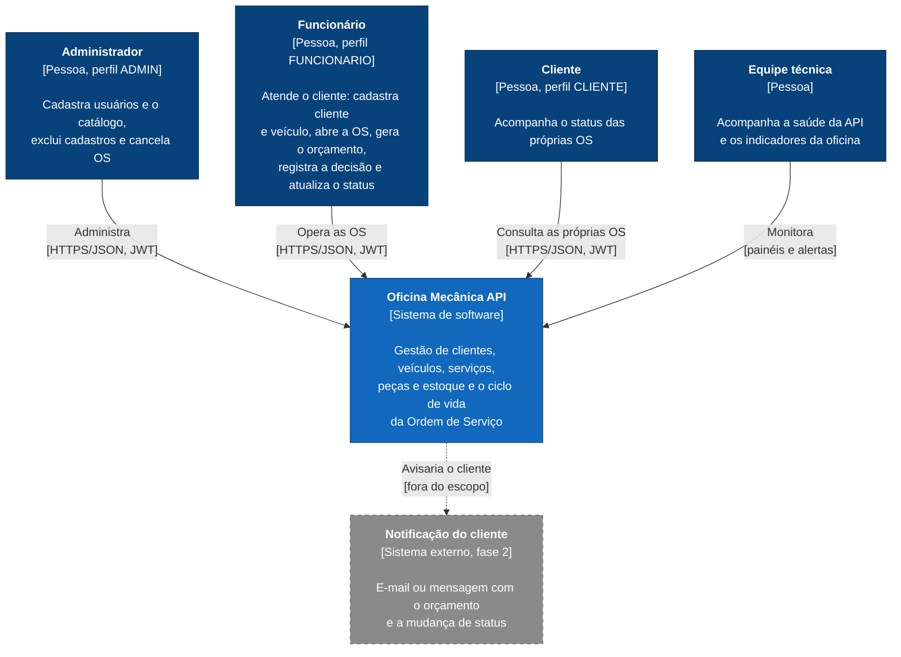
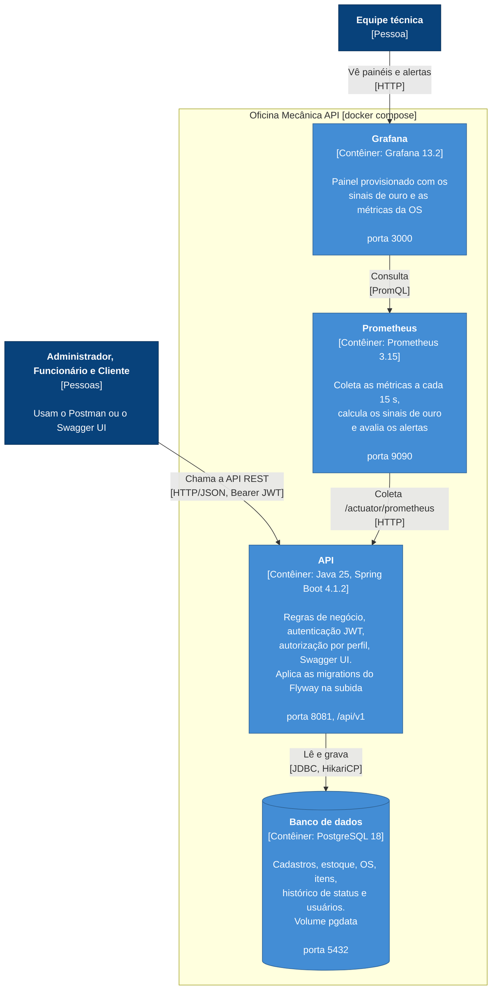
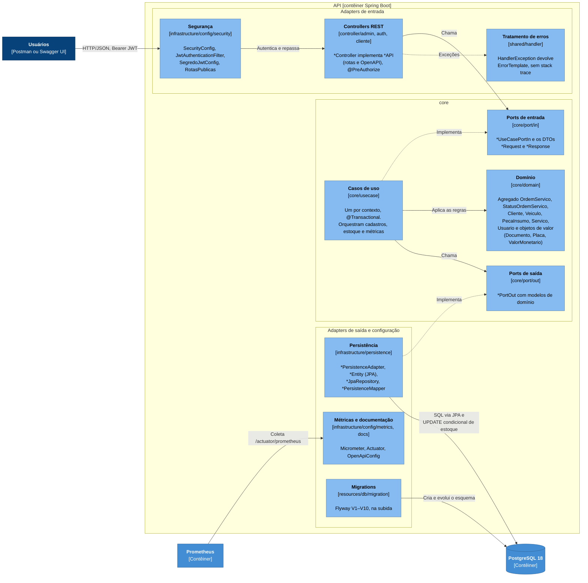

# Modelo C4: Oficina Mecânica API

Visão da arquitetura da fase 1 em três níveis do [modelo C4](https://c4model.com/): contexto, contêineres e
componentes da API. Os diagramas são do jeito que o sistema sobe pelo `docker-compose.yml` e do jeito que o código está
organizado. As decisões estão nas ADRs:
[001 (monólito em camadas)](../adr/0001-monolito-em-camadas.md),
[002 (banco de dados)](../adr/0002-escolha-do-banco-de-dados.md),
[003 (transações)](../adr/0003-estrategia-de-transacoes.md),
[004 (segurança)](../adr/0004-seguranca.md) e
[005 (testes)](../adr/0005-estrategia-de-testes.md).

Legenda das cores, em todos os níveis:

| Cor           | Elemento                                  |
|---------------|-------------------------------------------|
| Azul-escuro   | Pessoa (perfil de usuário)                |
| Azul          | O sistema ou um contêiner dele            |
| Azul-claro    | Componente dentro da API                  |
| Cinza         | Fora do sistema ou fora do escopo da fase |

## Nível 1: contexto

Quem usa o sistema e para quê. Na fase 1 não há front-end: os três perfis chamam a API REST pelo Postman ou pelo Swagger
UI, autenticados com JWT. Não há integração com sistemas externos em tempo de execução.

- **Permissões de cada perfil:** a matriz completa está na ADR 004, seção 4. O cliente só enxerga as próprias OS, e o
  `clienteId` vem do token, nunca da URL.
- **Aprovação do orçamento:** nesta fase, o cliente decide fora do sistema e o funcionário registra a decisão. A
  aprovação direta pelo cliente e a notificação ficam para a fase 2.
- **Ferramentas de desenvolvimento** (GitHub Actions, SonarCloud, Gitleaks e o SonarQube local) não fazem parte do
  sistema em execução e ficam fora do diagrama.

## Nível 2: contêineres

O que roda no `docker compose up`. A API é um monólito único (ADR 001) e é o único contêiner que os usuários chamam.

| Contêiner    | Imagem (compose)                 | Responsabilidade                                                                                     |
|--------------|----------------------------------|------------------------------------------------------------------------------------------------------|
| `api`        | build do `Dockerfile`            | Toda a regra de negócio. Sobe só depois do `db` saudável e expõe só `health` e `prometheus` no Actuator |
| `db`         | `postgres:18-alpine`             | Única fonte de dados. O esquema é das migrations V1–V10 do Flyway, com `ddl-auto: validate` (ADR 002) |
| `prometheus` | `prom/prometheus:v3.15.1`        | Regras dos sinais de ouro (`regras-sinais-ouro.yaml`) e alertas (`alertas.yaml`)                     |
| `grafana`    | `grafana/grafana:13.2.4`         | Fonte de dados e painel provisionados em `grafana/provisioning/`                                     |

- O `sonarqube` também está no `docker-compose.yml`, mas é ferramenta de desenvolvimento (análise local antes do PR) e
  não participa do sistema em execução.
- O Prometheus também tem um alvo para a API rodando fora do Docker (`host.docker.internal:8081`), para quem roda a API
  pela IDE.

## Nível 3: componentes da API

Como o contêiner `api` é organizado por dentro: monólito em camadas, no estilo ports & adapters (ADR 001). As setas
seguem a regra de dependência: o `core` não conhece o `controller` nem a `infrastructure`.

| Componente           | Pacote                                    | Pode depender de                                       |
|----------------------|-------------------------------------------|--------------------------------------------------------|
| Controllers REST     | `controller/<admin\|auth\|cliente>`       | `core/port/in`, `shared`                               |
| Ports de entrada     | `core/port/in/<contexto>`                 | `core/domain`                                          |
| Casos de uso         | `core/usecase/<contexto>`                 | `core/domain`, `core/port`, `shared`                   |
| Domínio              | `core/domain/<contexto>`                  | `shared/exception` e utilitários puros de `shared/utils` |
| Ports de saída       | `core/port/out/<contexto>`                | `core/domain`                                          |
| Persistência         | `infrastructure/persistence/<contexto>`   | `core/domain`, `core/port`, `shared`                   |
| Segurança            | `infrastructure/config/security`          | `core/port/in` (o filtro usa o `JwtTokenUseCasePortIn`) |
| Tratamento de erros  | `shared/handler`                          | `shared/exception`                                     |

Os contextos são os mesmos em todas as camadas: `auth`, `usuario`, `cliente`, `veiculo`, `servico`, `pecainsumo` e
`ordemservico`. O fluxo da OS passando por esses componentes, passo a passo, está nos
[diagramas de sequência](sequencia-ordem-servico.md).
