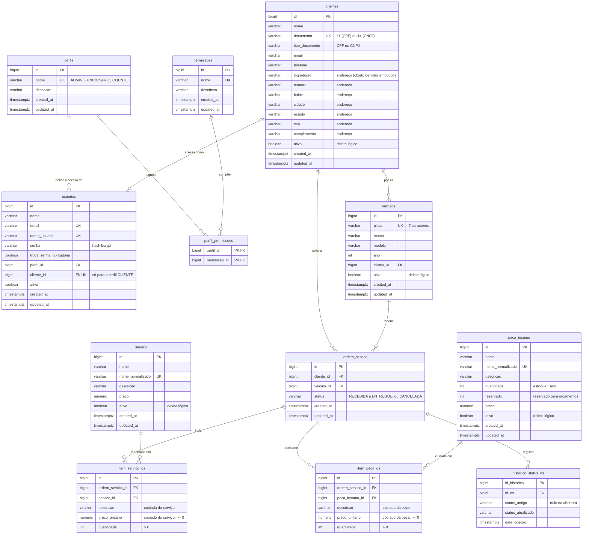

# DER: banco de dados

Modelo físico do PostgreSQL da fase 1, do jeito que fica depois das migrations V1 a V11. Como a aplicação sobe com
`ddl-auto: validate`, as entidades JPA precisam bater com essas tabelas. A escolha do banco e o histórico das migrations
estão na [ADR 002](../adr/0002-escolha-do-banco-de-dados.md); as transações e a reserva de estoque, na
[ADR 003](../adr/0003-estrategia-de-transacoes.md); os perfis, na [ADR 004](../adr/0004-seguranca.md).

Convenções do diagrama:

- `PK`, `FK` e `UK` marcam chave primária, chave estrangeira e `UNIQUE`. Os comentários entre aspas resumem os `CHECK`
  e as regras de cada coluna.
- Os tipos estão simplificados: `varchar` sem o tamanho, `numeric` é `numeric(12, 2)` e `timestamptz` é
  `timestamp(6) with time zone`.
- A `flyway_schema_history`, a tabela de controle do Flyway, fica de fora.

## Como ler

- **Usuário e perfil:** todo usuário tem exatamente 1 perfil. Nesta fase, a autorização é feita por perfil, e nenhuma
  migration popula `permissoes` nem `perfil_permissoes`. As tabelas ficam prontas para permissões mais finas na fase 2.
- **Usuário e cliente:** o `cliente_id` é opcional e único. Só o usuário com perfil `CLIENTE` fica ligado a um cliente,
  e cada cliente tem no máximo um usuário. É por esse vínculo que o cliente vê só as próprias OS.
- **Cliente:** tem vários veículos e várias OS. O endereço não tem tabela própria: é o objeto de valor `Endereco`,
  gravado nas colunas de `clientes` (`EnderecoEmbeddable`).
- **OS:** pertence a 1 cliente e a 1 veículo e tem vários itens de serviço, itens de peça e registros de histórico.
  O `status` só aceita os valores do `StatusOrdemServico` (`CHECK` no banco).
- **Itens da OS:** guardam a `descricao` e o `preco_unitario` do momento da inclusão, para o orçamento não mudar quando
  o cadastro de serviços e peças muda.
- **Estoque:** `quantidade` é o estoque físico e `reservado` é o que já foi separado para orçamentos. O disponível é
  `quantidade - reservado`. Os `UPDATE` de cada passo estão nos [diagramas de sequência da OS](sequencia-ordem-servico.md).
- **Histórico:** cada mudança de status gera uma linha em `historico_status_os`. É a base do tempo médio de execução
  (de `EM_EXECUCAO` a `FINALIZADA`).
- **Delete lógico:** clientes, veículos, serviços e peças são desativados pelo `ativo` (o catálogo desde a V11), e a OS
  vai para `CANCELADA`. Nada disso é apagado fisicamente: a OS antiga continua apontando para o serviço e a peça da
  época, que só deixam de aparecer no catálogo e de poder entrar em OS nova.

As tabelas `identidades`, `contatos` e `enderecos` (removidas na V8) e `servico_peca_insumo` (removida na V9) aparecem
nas migrations antigas, mas não existem mais.
