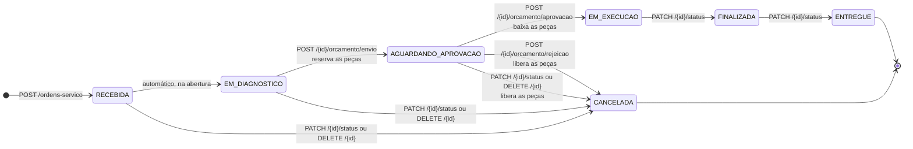

# Diagrama de estados: Ordem de Serviço

Status da OS e as transições permitidas, do jeito que está no código: `StatusOrdemServico.destinosPermitidos()` define
para onde cada status pode ir, e o agregado `OrdemServico` só muda de status pelos comandos de negócio. Uma transição
fora do diagrama responde **409**. O fluxo de cada comando, com as transações e o estoque, está
nos [diagramas de sequência](sequencia-ordem-servico.md).

Todas as rotas ficam sob `/api/v1/ordens-servico`.

## Regras

| Regra | Onde está no código |
|---|---|
| A OS avança uma etapa por vez, sem voltar nem pular. | `StatusOrdemServico.podeTransitarPara` |
| Toda OS aberta entra como `RECEBIDA` e vai sozinha para `EM_DIAGNOSTICO`, porque já tem cliente e veículo. O histórico registra as duas mudanças. | `OrdemServico.abrir` |
| `EM_DIAGNOSTICO` e `AGUARDANDO_APROVACAO` são automáticos: pedir um deles no `PATCH /{id}/status` responde 409. `AGUARDANDO_APROVACAO` vem do envio do orçamento, que exige ao menos um item. | `OrdemServicoUseCase.aplicarStatus`, `OrdemServico.aguardarAprovacao` |
| A aprovação do orçamento leva a OS direto para `EM_EXECUCAO`. A rejeição a leva para `CANCELADA`. | `iniciarExecucao`, `rejeitarOrcamento` |
| Serviços e peças só mudam em `RECEBIDA` ou `EM_DIAGNOSTICO`: depois do envio do orçamento, as peças já estão reservadas. | `OrdemServico.exigirItensEditaveis` |
| `CANCELADA` só é possível até `AGUARDANDO_APROVACAO`. Nesse status há reserva, e o cancelamento a devolve ao estoque. A OS nunca é apagada: o `DELETE` (só `ADMIN`) também a leva para `CANCELADA`. | `OrdemServico.cancelar`, `OrdemServicoUseCase.aplicarStatus` |
| `ENTREGUE` e `CANCELADA` são finais: não saem para nenhum outro status. | `StatusOrdemServico.isFinal` |
| Cada mudança grava no histórico o status antigo, o novo e a data e hora. O tempo de execução vai de `EM_EXECUCAO` a `FINALIZADA`. | `OrdemServico.registrarTransicao`, `getTempoExecucao` |
