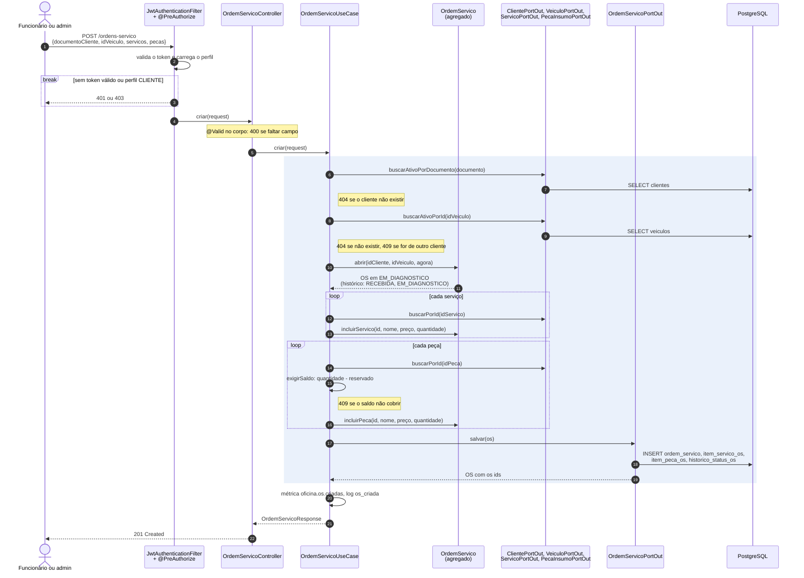
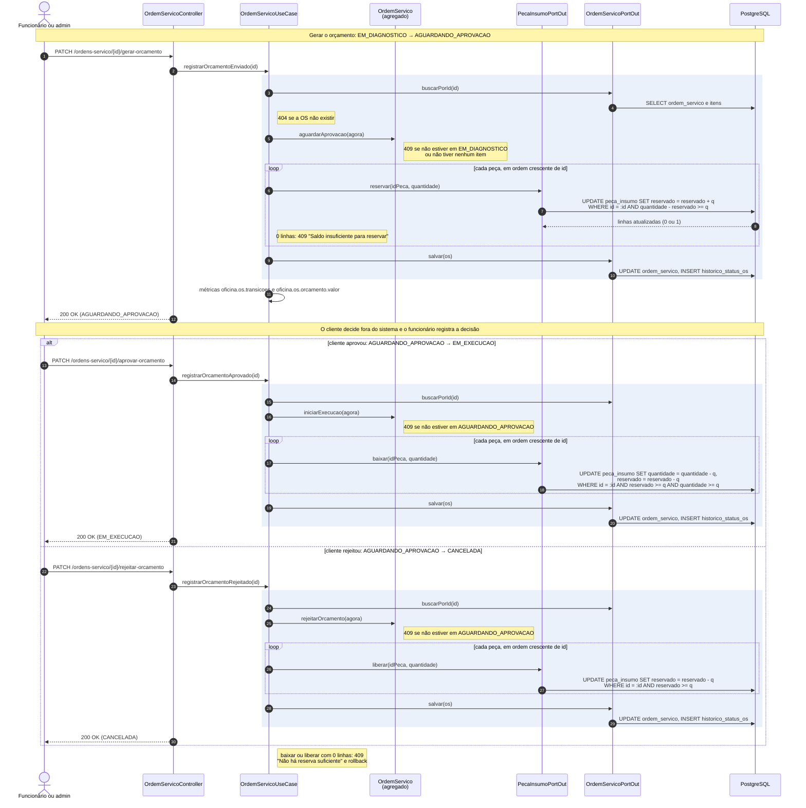
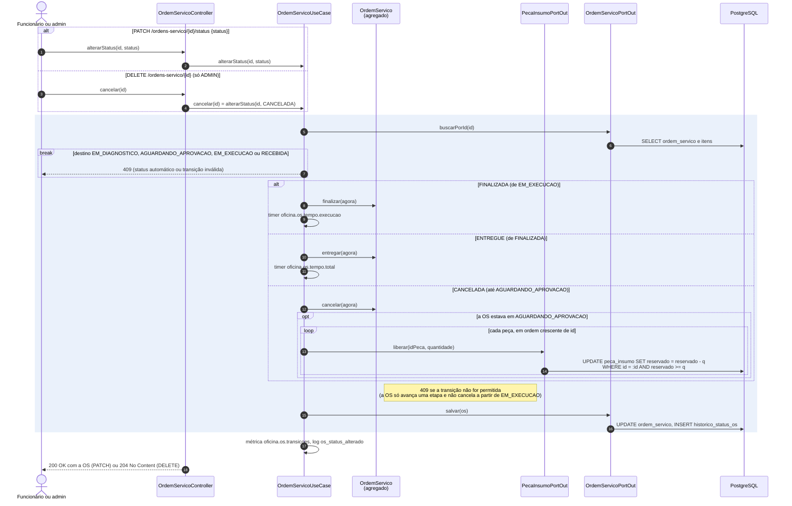

# Diagramas de sequência: Ordem de Serviço

Fluxo principal da fase 1, do jeito que está no código: abertura da OS, orçamento (gerar → aprovar ou rejeitar) e
mudança manual de status. As camadas seguem a [ADR 001](../adr/0001-monolito-em-camadas.md), as transações e o estoque a
[ADR 003](../adr/0003-estrategia-de-transacoes.md) e os perfis a [ADR 004](../adr/0004-seguranca.md).

Convenções dos diagramas:

- Todas as rotas ficam sob `/api/v1` e exigem `Authorization: Bearer <token>` de um usuário `ADMIN` ou `FUNCIONARIO`.
- Os `*PortOut` são interfaces do `core`. Quem fala com o PostgreSQL são os `*PersistenceAdapter` em
  `infrastructure/persistence/<contexto>/`, que aparecem aqui só pelo SQL que geram.
- A área destacada é a transação do caso de uso (`@Transactional` no `OrdemServicoUseCase`). Qualquer
  `ApplicationException` dentro dela desfaz tudo, e o `HandlerException` devolve o `ErrorTemplate` com o status
  (400, 404 ou 409).

## 1. Abertura da OS

`POST /ordens-servico`. A OS entra como `RECEBIDA` e vai sozinha para `EM_DIAGNOSTICO`, porque já tem cliente e veículo.
O preço de cada item é copiado do cadastro na inclusão, e a peça só tem o saldo conferido: a reserva fica para o
orçamento.

## 2. Orçamento: gerar, aprovar ou rejeitar

O orçamento não é uma entidade separada: é o conjunto de itens da OS, que fica congelado ao ser gerado. A decisão do
cliente acontece fora do sistema, e o funcionário a registra (ADR 004). Cada passo é uma requisição e uma transação.

O estoque muda por `UPDATE` condicional atômico (ADR 003, seção 2): se a condição do `WHERE` não vale, nenhuma linha é
atualizada, o caso de uso devolve 409 e a transação inteira volta. As peças são atualizadas em ordem crescente de `id`,
para duas transações que disputam as mesmas peças travarem as linhas na mesma ordem e não darem deadlock.

## 3. Mudança manual de status e cancelamento

Pelo `PATCH /status` só se finaliza, entrega ou cancela. Os outros status são automáticos (vêm da abertura e do
orçamento) e são recusados com 409. O `DELETE /ordens-servico/{id}` não apaga a OS: é o mesmo cancelamento, liberado
só para o `ADMIN`.

